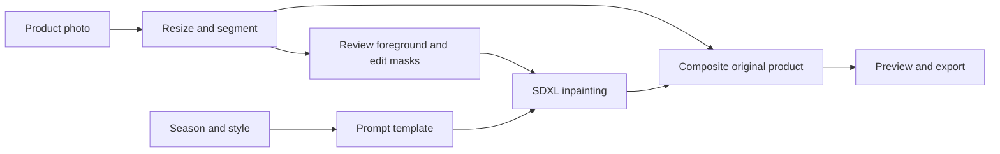

# SeasonVision AI

Seasonal Campaign Visual Generator — a GenAI course project that aims to turn an existing product photograph into seasonal retail imagery while preserving the product's identity.

**Status: planning and reference inspection.** Application code, model execution and performance results are not yet available. Pretrained-model use is a working assumption pending instructor confirmation.

## Planned experience

1. Upload a product photograph.
2. Inspect and, if needed, correct the foreground mask.
3. Select Diwali, Christmas or Summer and a visual style.
4. Review an editable seasonal scene prompt.
5. Generate a background with pretrained SDXL inpainting.
6. Composite the original product, compare before/after, and download the result and settings.

Start with square images and one result per request. Product preservation, seasonal relevance and explainable behavior are the priorities.

## Architecture

Proposed stack: Python, Gradio, Pillow, PyTorch and Hugging Face Diffusers, plus a pretrained foreground segmenter selected during testing. First image-model candidate: [`diffusers/stable-diffusion-xl-1.0-inpainting-0.1`](https://huggingface.co/diffusers/stable-diffusion-xl-1.0-inpainting-0.1). Its runtime and output quality have not been tested here.

The notebook and app will share the same pipeline functions. The initial backend directly calls the model through Diffusers. Supplied ComfyUI graphs are references for masking, generation and compositing; their custom nodes are not all required by the planned app.

## Free compute and demonstration

- Use available free Colab compute for interactive notebook research.
- Test and run the browser-based Gradio demo on suitable local hardware, potentially a borrowed laptop. Hardware availability/specifications remain pending.
- Free Colab is not the planned web-app host: its [FAQ](https://research.google.com/colaboratory/faq.html) restricts primarily interacting through a separate web UI and does not guarantee GPUs.
- If SDXL cannot run acceptably on available hardware, evaluate a smaller SD 1.5 inpainting configuration before adding features.
- Keep saved examples and a recording as explicitly labelled backup evidence. Rehearse live generation on the actual demo machine.

No paid inference API, subscription or public hosting is required by this plan. Browser-based does not imply publicly hosted: the app can open on localhost.

## Build milestones

- [x] Recover project decisions and inspect supplied workflows.
- [x] Record implementation plan and study-note maintenance process.
- [ ] Confirm course requirement and inspect available demo hardware.
- [ ] Obtain reliable foreground masks and one real image-generation baseline.
- [ ] Preserve product pixels and compare against raw inpainting.
- [ ] Implement seasonal prompts and complete the app flow.
- [ ] Evaluate 5 products across 3 seasons; record failures and timing.
- [ ] Rehearse the demo and prepare evidence-backed viva explanations.

See [the build plan](docs/PROJECT_PLAN.md) for decision gates, modules and acceptance evidence. No install/run command is published until the environment is implemented and verified.

## Academic contribution

Planned team work includes seasonal prompt construction, automated mask handling, product-preserving compositing, the application interface and evaluation. Model weights and reference workflows remain upstream contributions. The application performs inference unless a future documented training experiment is added.

Evaluation will cover product/logo fidelity, seasonal relevance, visual artifacts, lighting/edges, generation time and retries. Human rubric scores will be described as such, not as classification accuracy.

## References and repository contents

- [Pixaroma background-replacement tutorial](https://www.youtube.com/watch?v=_-uEw4f_sG4) and user-supplied workflow files in `refrences/pixaroma-background-replacement/`.
- [Furkan's Windows adaptation of Shopify background replacement](https://github.com/FurkanGozukara/background-replacement), an earlier project reference.
- [Shopify background-replacement source mirror](https://github.com/camenduru/background-replacement-hf).
- [Diffusers inpainting documentation](https://huggingface.co/docs/diffusers/using-diffusers/inpaint).

`docs/` contains the implementation plan. Original reference assets retain their filenames. Local academic material and personal study notes are ignored by Git. Retain upstream attribution and review code/model licenses before reusing or redistributing components.
